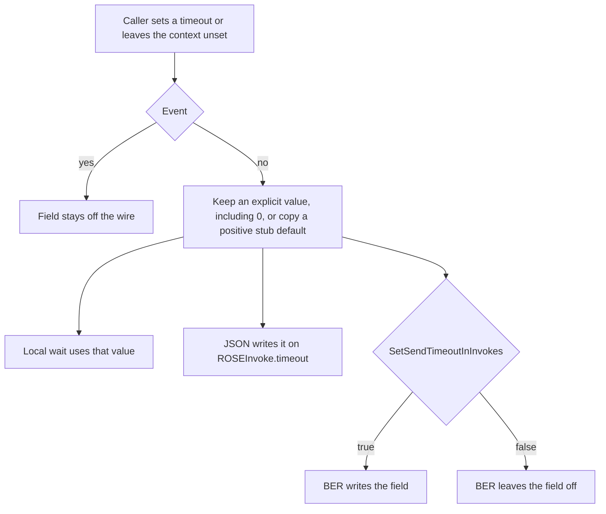

# ROSE invoke timeout

`ROSEInvoke.timeout` is an optional relative deadline in milliseconds (`[4] IMPLICIT INTEGER` in `ROSE/SNACCROSE.asn1`). The same number is the local wait on the caller. An event (`invokeID` 99999) never carries the field.

C++ and TypeScript implement the same resolve and encode rules. The [deviations](#deviations) section is the only place a difference is allowed to exist without being called a bug.

## Where it sits

The ASN.1 comment evaluates a present timeout on the server as `deadline = T_receive + timeout`. The library copies that value onto the inbound context. Dropping expired work that is still queued is the [worker pool](rose-worker-pools.md) deadline. A product may also discard expired work. The library does not drop an invoke that runs immediately on the calling thread.

## Shared behavior

- Three states on the context. Unset means the stub default applies. `0` is fire-and-forget. A value above `0` is a deadline in milliseconds.
- Both languages start from 20000 ms (`m_lMaxInvokeWait`, `defaultTimeout`).
- A positive default is copied onto an unset non-event context before send, so the local wait and the wire value are the same number. A non-positive default leaves the context unset. The encode still succeeds and the optional field stays off the wire.
- An explicit `0` stays `0`. The local wait does not block. JSON writes `0`. BER writes `0` only when the BER switch is on.
- JSON writes every resolved non-event value, including `0`. BER writes that value only after `SetSendTimeoutInInvokes(true)` / `setSendTimeoutInInvokes(true)`. The default is false. Turn it on only when the other side already understands `ROSEInvoke.timeout`. A peer that does not know the field fails BER decoding of any invoke that carries it. The local wait does not consult this switch.
- An event omits the field even when the context holds a timeout.
- Inbound context copies `ROSEInvoke.timeout` when the field is present, including `0`. An absent field leaves the context unset.
- The worker pool does not treat a wire `0` as already expired. See [rose-worker-pools.md](rose-worker-pools.md).

## API

Casing follows the naming map in `.cursor/rules/rose-cross-language-parity.mdc`.

| C++ | TypeScript | Role |
| --- | --- | --- |
| `SetInvokeTimeout` | `setInvokeTimeout` | Store milliseconds on the context, including `0` |
| `ClearInvokeTimeout` | `clearInvokeTimeout` | Back to unset, so the next send applies a positive default |
| `InvokeTimeout` | `invokeTimeout` | The stored value, or empty when unset |
| `SetMaxInvokeWaitTime` / `GetMaxInvokeWaitTime` | `defaultTimeout` / `getDefaultInvokeTimeout` | Stub default. `defaultTimeout` is protected |
| `SetSendTimeoutInInvokes` / `GetSendTimeoutInInvokes` | `setSendTimeoutInInvokes` / `getSendTimeoutInInvokes` | BER wire switch. Default false |
| `CreateOutboundInvokeContext` | `SendInvokeContext` constructor `invokeTimeoutMs` | Apply an explicit timeout, or leave the default |

Sources:

- `ROSE/SNACCROSE.asn1`
- `cpp-lib/include/SnaccROSEInterfaces.h`
- `cpp-lib/include/SnaccROSEBase.h`
- `cpp-lib/src/SnaccROSEBase.cpp`
- `compiler/back-ends/ts-gen/gluecode/TSROSEBase.ts`
- `compiler/back-ends/ts-gen/gluecode/TSASN1Base.ts`

## Deviations

A row here is a decision, not a backlog item. Remove the row when the difference goes away. Add a row in the same change that introduces a difference.

| Topic | C++ | TypeScript | Why this is allowed |
| --- | --- | --- | --- |
| Local completion | `SendInvoke` returns `ROSE_TE_TIMEOUT` when the wait ends with no answer. Timeout `0` returns `ROSE_NOERROR` after the send and does not wait. | The client `sendInvoke` promise resolves a `ROSEReject` whose `invokeProblem` is `requestTimedOut` (504). Timeout `0` resolves `undefined` and does not keep a pending invoke. | `sendInvoke` returns the peer ROSE message. A local timer has no peer message, so the client builds that reject. `0` has nothing to wait for, so the promise settles empty. |
| Empty timeout | `std::optional<unsigned int>` | `number` or `undefined` | Language optionals. Unset and absent are the empty state in both. |
| Method casing | `PascalCase` | `camelCase` | Language naming map. |

## Tests

| Behavior | C++ | TypeScript |
| --- | --- | --- |
| Unset, `0`, and an explicit value | `CreateOutboundInvokeContextOptionalTimeout` | `CreateOutboundInvokeContextOptionalTimeout: unset, zero, and explicit ms` |
| Clear returns to unset | `ClearInvokeTimeoutRestoresUnset` | `ClearInvokeTimeoutRestoresUnset` |
| Inbound copies the wire value, including `0`, and leaves an absent field unset | `InboundInitCopiesWireInvokeTimeout`, `InboundInitCopiesZeroWireTimeout`, `InboundInitWithoutWireTimeoutLeavesUnset` | The same three names in `TSROSEBase.invokeTimeout.test.ts` |
| JSON writes the resolved value. BER writes it only after the switch | `OutboundWireInvokeTimeoutReachesInboundHandlerJson` / `Ber`, `OutboundBerOmits*ByDefault` | `OutboundWireInvokeTimeoutEncodesOnInvokeJson`, `OutboundWireInvokeTimeoutEncodesOnInvokeBer`, `OutboundWithoutInvokeContextWritesTimeoutWhenEnabledBer` |
| Fire-and-forget writes `0` | `OutboundFireAndForgetEncodesZeroTimeoutOnInbound` / `Ber` | `OutboundFireAndForgetEncodesZeroTimeout`, `OutboundFireAndForgetEncodesZeroTimeoutBer` |
| A non-positive default omits the field | `OutboundSuppressedConnectionDefaultOmitsInvokeTimeoutJson` / `Ber` | `OutboundSuppressedStubDefaultOmitsOptionalTimeout` / `Ber` |
| An event omits the field | `OutboundEventOmitsInvokeTimeoutOnWireJson` / `Ber` | `OutboundEventOmitsWireTimeoutEvenWhenSet` / `Ber` |

## How this file stays current

Update this file in the same change as the code when the timeout states, the wire rules, or the local wait change, or when C++ and TypeScript stop doing the same thing. A new difference needs a row in the deviations table and a pair of tests.
