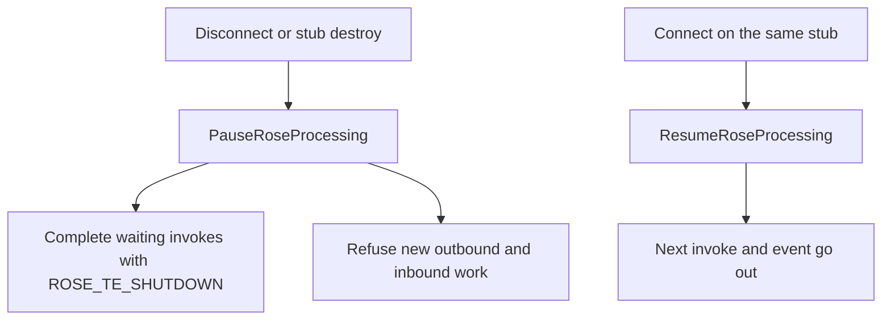

# ROSE processing gate

`PauseRoseProcessing` ends the current ROSE session on one stub. New work is refused and every invoke that is still waiting completes with `ROSE_TE_SHUTDOWN`. `ResumeRoseProcessing` opens the next session on the same object. It does not bring back work from the session that just ended.

ProCall uses this pair on the client. `ENetCtiClientBase::OnDisconnect` pauses. `OnConnect` resumes. The UCServer transport borrows ROSE worker pools; destroying a C++ stub pauses, and that pause also drops queued pool work for that stub.

C++ and TypeScript implement the same session rules. The [deviations](#deviations) section is the only place a difference is allowed to exist without being called a bug.

## Where it sits

A late result or error for an invoke that pause already completed is ignored. It must not turn that shutdown into a success, and it must not block the next session.

## Shared behavior

- Pause closes the gate first, then completes pending invokes with `ROSE_TE_SHUTDOWN`.
- A new outbound invoke while the gate is closed fails with `ROSE_TE_SHUTDOWN` and is not sent.
- A new outbound event is not sent and returns `ROSE_TE_SHUTDOWN`.
- An inbound invoke or event is not delivered to the application handler. The caller gets a shutdown reject.
- Resume sets the gate open again. The next invoke and the next event use the new session.
- Resume does not replay or revive the completed invokes.

## API

Casing follows the naming map in `.cursor/rules/rose-cross-language-parity.mdc`.

| C++ | TypeScript | Role |
| --- | --- | --- |
| `PauseRoseProcessing` | `pauseRoseProcessing` | Close the session and complete pending invokes |
| `ResumeRoseProcessing` | `resumeRoseProcessing` | Open the next session on this stub |
| `IsProcessingAllowed` | `isProcessingAllowed` | False while the gate is closed |
| `CompleteIfProcessingShutdown` | `completeIfProcessingShutdown` | Shutdown reject when the gate is closed, otherwise nothing |

Sources:

- `cpp-lib/include/SnaccROSEBase.h`
- `cpp-lib/src/SnaccROSEBase.cpp`
- `compiler/back-ends/ts-gen/gluecode/TSASN1Base.ts`

## Deviations

| Topic | C++ | TypeScript | Why this is allowed |
| --- | --- | --- | --- |
| Worker pools | When the stub has borrowed pools, pause rejects that stub's queued work and waits for a handler that already started. The handler sees the closed gate and does not send its reply. | No pool runtime. | TypeScript has no worker pools. The UCServer uses the C++ pools. The pool contract is [rose-worker-pools.md](rose-worker-pools.md). |
| Async completion | `FinishAsyncInvoke` completes a callback invoke. | The pending `Promise` resolves with `ROSE_TE_SHUTDOWN`. | One completion channel in JavaScript. The outcome is the same shutdown code. |
| Stub lifetime | The destructor calls `PauseRoseProcessing`. | The caller calls `pauseRoseProcessing`. | JavaScript has no deterministic destructor. |
| Encode failure on an event | `Send` throws or returns the prefix result. The event is not sent. | `handleEvent` returns the `AsnInvokeProblem` value, or `ROSE_TE_TRANSPORTFAILED` when that value is missing. | The generated `event_*` method stays synchronous and numeric. The caller still sees a non-zero local code. |
| Method casing | `PascalCase` | `camelCase` | Language naming map. |
| Result type | Unscoped `ERoseResult` converts to `long`. | Numeric enum `ERoseResult`, assignable to `number`. | Same values. Existing `long` call sites keep compiling. |

## Tests

| Behavior | C++ | TypeScript |
| --- | --- | --- |
| New outbound invoke and event are refused | `PauseRoseProcessingBlocksNewOutboundInvokesAndEvents` | `pauseRoseProcessing blocks outbound invoke and event sends` |
| Pending invoke completes with shutdown | `PauseRoseProcessingCompletesPendingInvokeWithShutdownBer` / `Json` | `pauseRoseProcessing completes pending invokes with shutdown` |
| Inbound stays undispatched until resume | `PauseRoseProcessingBlocksInboundDispatchUntilResumed` | `pauseRoseProcessing blocks inbound dispatch until resumeRoseProcessing` |
| Resume lets the next invoke and event through | `ResumeRoseProcessingAllowsNextOutboundInvoke` | `resumeRoseProcessing allows the next outbound invoke` |
| Event send returns the local ROSE code | `SendEvent` returns `ROSE_TE_SHUTDOWN` in `PauseRoseProcessingBlocksNewOutboundInvokesAndEvents`; a failed socket write returns `ROSE_TE_TRANSPORTFAILED` from `Send` | `sendEvent returns the same local codes as C++ SendEvent` |
| Late result does not replace shutdown | `LateResultAfterPauseDoesNotResurrectPendingInvoke` | `late result after pauseRoseProcessing does not replace the shutdown reject` |
| Async callback completes with shutdown | `PauseRoseProcessingCompletesAsyncInvokeWithShutdownJson` | The pending-promise test above |
| Queued pool work is dropped | `PauseRejectsQueuedWorkAndDropsInflightReply` | No TypeScript counterpart |

## How this file stays current

Update this file in the same change as the code when the gate's behavior changes or when C++ and TypeScript stop doing the same thing. A new difference needs a row in the deviations table and a pair of tests.
