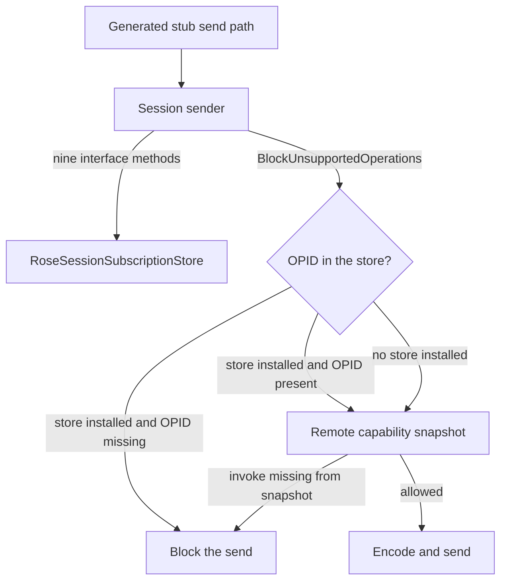

# ROSE session subscription store

Per-session memory of which operation IDs (OPIDs) a logged-in session may receive. Events and invokes are separate sets. One module can be replaced or cleared without touching the other modules.

C++ and TypeScript implement the same rules. The [deviations](#deviations) section is the only place a difference is allowed to exist without being called a bug. If a change is not in that table, the two languages are out of date with each other.

## Where it sits

The store is not on the TCP connection. It hangs off the session sender. Generated stubs call the sender. A product (UCServer on the connection, a TypeScript server transport) owns a `RoseSessionSubscriptionStore` and forwards the nine interface methods to it.

A sender that has not installed a store allows every OPID through the session check. Only the remote-capability check can still block an invoke. An installed store is authoritative immediately: an empty set blocks that OPID when the policy is `BlockUnsupportedOperations`. `NeverBlock` does not consult the store.

## Shared behavior

These rules are the same in both languages.

- Four containers: events by module, flat event OPIDs, invokes by module, flat invoke OPIDs. `IsSubscribedEvent` / `isSubscribedEvent` and `IsSupportedInvoke` / `isSupportedInvoke` read the flat sets.
- `Set*` / `set*` replaces one module. The previous OPIDs of that module leave the flat set, then the new list is inserted. An empty list clears that module only.
- `Clear*` / `clear*` drops one module, or the whole session for `ClearAllSubscriptions` / `clearAllSubscriptions`.
- `Add*` / `add*` inserts one OPID into that module and into the flat set. Other modules stay.
- OPIDs are not reference-counted. The same OPID stored for two modules disappears from the flat set when either module is cleared.
- Unknown module on clear is a no-op.
- Writes on a sender that has no store assert. The two queries on that sender return true until a store is installed.

## API

Casing follows the naming map in `.cursor/rules/rose-cross-language-parity.mdc`. The words are the same.

| C++ | TypeScript | Role |
| --- | --- | --- |
| `ISnaccRoseSessionSubscription` | `IRoseSessionSubscription` | Interface |
| `RoseSessionSubscriptionStore` | `RoseSessionSubscriptionStore` | In-memory store |
| `ClearAllSubscriptions` | `clearAllSubscriptions` | Drop events and invokes |
| `ClearSubscribedEvents` | `clearSubscribedEvents` | Drop one module's events |
| `ClearSupportedInvokes` | `clearSupportedInvokes` | Drop one module's invokes |
| `SetSubscribedEvents` | `setSubscribedEvents` | Replace one module's events |
| `AddSubscribedEvent` | `addSubscribedEvent` | Insert one event |
| `SetSupportedInvokes` | `setSupportedInvokes` | Replace one module's invokes |
| `AddSupportedInvoke` | `addSupportedInvoke` | Insert one invoke |
| `IsSubscribedEvent` | `isSubscribedEvent` | Flat event lookup |
| `IsSupportedInvoke` | `isSupportedInvoke` | Flat invoke lookup |
| `ClearModuleOpIds` | `clearModuleOpIds` | Private. Remove one module from a map and from the flat set |
| `ReplaceModuleOpIds` | `replaceModuleOpIds` | Private. Clear then insert |

| C++ member | TypeScript member | Role |
| --- | --- | --- |
| `m_subscribedEventsByModule` | `subscribedEventsByModule` | Module to event OPIDs |
| `m_subscribedEventOpIds` | `subscribedEventOpIds` | Flat event lookup |
| `m_supportedInvokesByModule` | `supportedInvokesByModule` | Module to invoke OPIDs |
| `m_supportedInvokeOpIds` | `supportedInvokeOpIds` | Flat invoke lookup |
| `m_lock` | none | See deviations |

Sources:

- `cpp-lib/include/RoseSessionSubscriptionStore.h`
- `cpp-lib/include/ISnaccRoseSessionSubscription.h`
- `compiler/back-ends/ts-gen/gluecode/RoseSessionSubscriptionStore.ts`
- `compiler/back-ends/ts-gen/gluecode/IRoseSessionSubscription.ts`

Glue tests copy the TypeScript sources into `typescript/stub/`. The copies under `samples/ts-microservice/**/src/stub/` are generated output, not a second implementation.

## Deviations

A row here is a decision, not a backlog item. Remove the row when the difference goes away. Add a row in the same change that introduces a difference.

| Topic | C++ | TypeScript | Why this is allowed |
| --- | --- | --- | --- |
| Thread safety | `std::shared_mutex`. Readers take a shared lock. Writers take a unique lock for the whole replace or clear. Private helpers do not lock again. | No lock. | The TypeScript runtime is one event loop, which is the serializer. The set rules stay the same. |
| Lock field | `m_lock` | No member | Same reason. A TypeScript lock object would not match the runtime. |
| Interface prefix | `ISnaccRoseSessionSubscription` | `IRoseSessionSubscription` | Existing type names. The method list is the contract. |
| Method and member casing | `PascalCase` methods, `m_camelCase` members, `ui` prefix on unsigned parameters | `camelCase` methods and members, no `m_` or `ui` | Language naming map. The words match the table above. |
| OPID parameter type | `Set*` takes `const std::list<int>&`. `Add*` and `Is*` take `unsigned int`. Insert casts `int` to `unsigned int`. | `readonly number[]` and `number`. The value is stored as passed. | Language number types. Callers pass non-negative OPIDs. A negative list entry becomes a large unsigned value in C++ and stays negative in TypeScript. That edge is not a supported input. |
| Containers | `std::unordered_map`, `std::unordered_set`, `std::list` | `Map`, `Set`, array | Language containers. Lookup, replace, and clear behave as in [Shared behavior](#shared-behavior). |
| Client loopback tests | `snacclib_ClientInvokeBlockPolicyRuntimeTest` drives a real client endpoint | The glue tests call `isOperationBlocked` on a stub transport | TypeScript has no C++ loopback harness. The session-store matrix and the block-policy outcomes are paired. See the test matrix in `runtime_correctness_notes.md`. |

## Tests

| Behavior | C++ | TypeScript |
| --- | --- | --- |
| Replace, clear, add, unknown module | `snacclib_RoseSessionSubscription.*` | `TSASN1Base.roseSessionSubscription.test.ts` |
| Empty store blocks when the policy is on | `BlocksEventAndInvokeAbsentFromTheStore` | `subscription path: blocks event and invoke absent from the store` |
| One event or invoke missing | `BlocksUnsubscribedEvent`, `BlocksUnsupportedInvoke` | `subscription path: blocks unsubscribed event`, `subscription path: blocks unsupported invoke` |
| `NeverBlock` | `NeverBlockDoesNotBlock` | covered by the negotiate tests that keep the policy off the session path |
| Sender without a store still sends | `BlockUnsupportedOperationsWithoutSnapshotDoesNotBlockInvoke` | `negotiate path: blockUnsupportedOperations without snapshot does not block sendInvoke` |

## How this file stays current

Update this file in the same change as the code when any of these happen:

- a public method, member, or parameter is added or renamed
- set, clear, or lookup behavior changes
- C++ and TypeScript stop doing the same thing

The deviations table must name the difference and why it is acceptable. A matching pair of tests has to land in the same change. Code comments at the definition stay as well; they do not replace this file.
