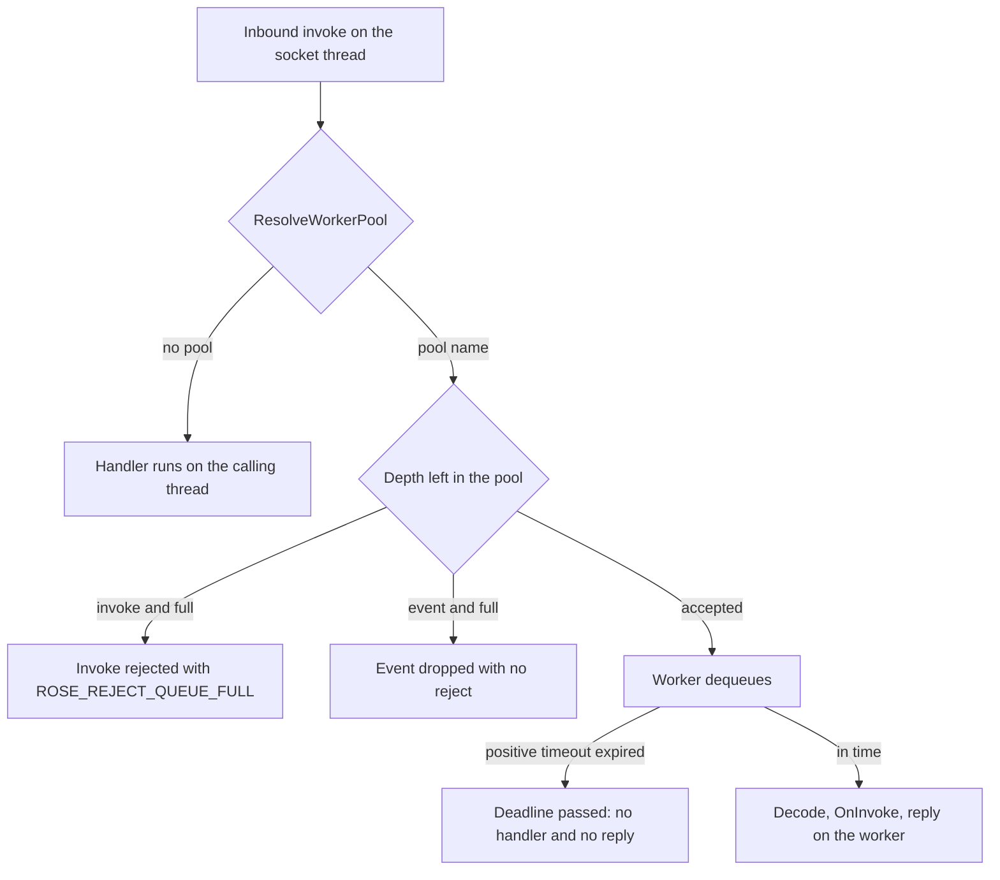

# ROSE worker pools

A process owns one `SnaccWorkerPools` registry, the same lifetime as a listener's `SnaccRoseOperationLookup`. `Configure` names the pools and starts them. Each `SnaccROSEBase` borrows that object with `SetWorkerPools`. Stubs that borrow it share the threads and the operation-id assignment. A stub that has not borrowed a registry runs every invoke on the calling thread.

TypeScript has no pool runtime. The [deviations](#deviations) section records that. The UCServer uses the C++ pools.

## Where it sits

`PauseRoseProcessing` on one stub rejects that stub's queued items and drops the reply of a handler that already started. Other stubs on the same registry keep running. The session rules are in [rose-processing-gate.md](rose-processing-gate.md).

## Shared behavior

These rules are the C++ contract.

- `Configure` takes name, `maxThreads`, `maxElements`, `idleTimeoutMs`, `faultPolicy`, and `operationIds`. It starts one floor thread per pool before any invoke. `maxThreads` below 1 is treated as 1. An operation id listed twice is refused: `Configure` returns false, asserts in debug, and keeps the previous set. A repeated pool name is skipped and its operation ids are not registered.
- `ResolveWorkerPool` returns true and writes the pool name when the invoke is handed to a pool. False leaves it on the calling thread. The default reads the borrowed registry. A module may override it.
- `DecideInlineExecution` returns `Execute`. A connection overrides it. ROSE asks the override only when the message would still run on this thread, and passes whether the invoke id is 99999. `RejectQueueFull` finishes an unpooled invoke as `ROSE_REJECT_QUEUE_FULL` and does not run the handler. An event is dropped with no reject. The override counts that on its pool's `HPSSThreadPoolHealth` when it returns `RejectQueueFull`. `Execute` runs the handler here. The socket pool does not call into ROSE.
- One FIFO per pool. `maxElements` counts waiting items plus items inside a handler. `0` means no depth limit. A full pool rejects an invoke with `ROSE_REJECT_QUEUE_FULL` (`resourceLimitation`, detail `queueFull`) and does not run the handler. An event (`invokeID` 99999) is dropped with no reject.
- The worker decodes the argument, calls `OnInvoke`, sends the reply, and finalizes inbound telemetry. The reply goes out through `SendBinaryDataBlockEx` on the stub that received the invoke.
- The floor thread is named `wp::<pool>` and stays until `Shutdown`. Further threads start when every live thread is busy, up to `maxThreads`. A thread above the floor waits `idleTimeoutMs` (default 30000) on an empty queue and then exits. `0` keeps every started thread until `Shutdown`.
- A `SnaccException` from the handler becomes a mistyped-argument reject and the thread stays. Any other exception follows `SnaccWorkerFaultPolicy`. `KeepWorker` swallows it and takes the next item. `RetireWorker` ends that thread and starts a replacement when work remains. Neither path sends a reply for the failed item.
- A positive `ROSEInvoke.timeout` is captured at enqueue as `T_enqueue + timeout`, so time spent queued counts. If that instant has passed when the worker dequeues the item, the handler does not run and the server sends no reply. The caller's own wait then completes locally. See [rose-invoke-timeout.md](rose-invoke-timeout.md). An absent or non-positive timeout is not a deadline, so the handler still runs.
- `PauseRoseProcessing` and destroying the stub reject that stub's queued invokes with the shutdown reject and do not run those handlers. A handler of that stub already running finishes, and its reply is discarded. `Shutdown` rejects every stub and joins the workers.
- `m_multithreadInvokeIDs` is not a pool. It chooses whether `OnBinaryDataBlockResult` accepts the invoke on that entry point. A pool chooses the worker thread.

## API

| C++ | TypeScript | Role |
| --- | --- | --- |
| `SnaccWorkerPools` | none | Shared registry |
| `SnaccWorkerPoolConfig` | none | One pool's name, limits, fault policy, and operation ids |
| `Configure` | none | Replace the set and start one floor thread per pool |
| `Shutdown` | none | Reject remaining work and join the workers |
| `SetWorkerPools` | none | Borrow the registry. Null leaves invokes on the calling thread |
| `ResolveWorkerPool` | none | Pool name for one operation id, or stay on the calling thread |
| `RejectQueuedAndWait` | none | Drop one stub's queue and wait for its running handlers |
| `Enqueue` | none | Hand one inbound message to a named pool |
| `DecideInlineExecution` | none | Virtual. Default `Execute`. An override returns `RejectQueueFull` to refuse an unqueued message and counts the outcome |

The registry must outlive every stub that borrows it, or the caller passes `nullptr` to `SetWorkerPools` first. Replacing a previous registry drains that stub's queued items and waits until its handlers return. Do not call `SetWorkerPools` from a pool worker that is running that stub.

Sources:

- `cpp-lib/include/SnaccWorkerPools.h`
- `cpp-lib/src/SnaccWorkerPools.cpp`
- `cpp-lib/include/SnaccROSEBase.h`
- `cpp-lib/src/SnaccROSEBase.cpp`

## Deviations

A row here is a decision, not a backlog item. Remove the row when the difference goes away.

| Topic | C++ | TypeScript | Why this is allowed |
| --- | --- | --- | --- |
| Pool runtime | Named pools, shared threads, depth, and the enqueue deadline. | No pool runtime. Every invoke runs on the caller that received it. | TypeScript has no worker pools. The UCServer uses the C++ pools. |
| Last accepting socket thread | `DecideInlineExecution` can answer `RejectQueueFull` for an unqueued invoke and counts it. | No socket pool and no override. | TypeScript has no high-performance socket thread pool. |
| Pause of queued work | Pause rejects that stub's queued items and drops an in-flight reply. | No queued pool work to reject. | Same reason. The session gate itself is shared. See [rose-processing-gate.md](rose-processing-gate.md). |

## Tests

| Behavior | C++ | TypeScript |
| --- | --- | --- |
| Unassigned operation and a stub without a registry stay on the calling thread | `UnassignedOperationStaysOnCallingThread`, `StubWithoutBorrowedPoolsStaysOnCallingThread` | No TypeScript counterpart |
| Last accepting thread refuses an unpooled invoke, drops an unpooled event, and still queues a pooled invoke | `RefuseInlineExecutionRejectsUnpooledInvoke`, `RefuseInlineExecutionDropsUnpooledEvent`, `PooledInvokeIsQueuedWhenInlineWouldBeRefused` | No TypeScript counterpart |
| Assigned operation runs off the calling thread, in FIFO order | `AssignedOperationRunsOffCallingThread`, `SingleWorkerKeepsFifoOrder` | No TypeScript counterpart |
| Two stubs share one registry | `SharedRegistryRunsBothStubsOnOneWorker` | No TypeScript counterpart |
| Full depth rejects an invoke and drops an event | `FullQueueRejectsInvokeWithoutHandler`, `FullQueueDropsEventWithoutReject` | No TypeScript counterpart |
| A duplicate operation id keeps the previous set | `DuplicateOperationIdIsRejectedAndPreviousSetStays` | No TypeScript counterpart |
| Floor thread starts at configure. Extra threads leave after idle | `ConfigureStartsOneThreadBeforeAnyInvoke`, `ExtraThreadsLeaveAfterIdleAndOneRemains` | No TypeScript counterpart |
| Handler exception keeps or retires the worker | `KeepWorkerHandlesNextInvokeAfterHandlerException`, `RetireWorkerStartsReplacementAfterHandlerException` | No TypeScript counterpart |
| Expired queued invoke does not run. Wire `0` still runs | `ExpiredQueuedInvokeDoesNotRunHandler`, `ZeroTimeoutQueuedInvokeStillRunsHandler` | No TypeScript counterpart |
| Pause drops only that stub's queue | `PauseRejectsQueuedWorkAndDropsInflightReply`, `PauseDropsOnlyThePausingStubsQueuedInvoke` | No TypeScript counterpart |

The C++ names are cases of `snacclib_WorkerPoolRuntimeTest` in `cpp-lib/tests/worker_pool/worker_pool_tests.cpp`.

## How this file stays current

Update this file in the same change as the code when pool routing, depth, the deadline, or shutdown of queued work changes. A TypeScript pool runtime needs a deviations-table edit in that same change, and paired tests.
